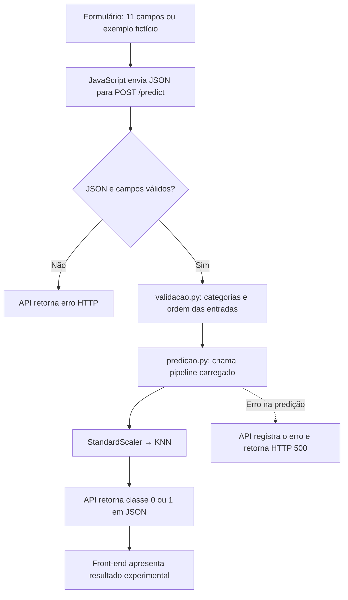
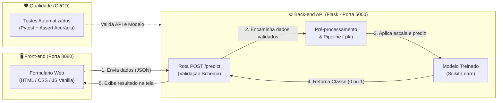

# MVP acadêmico: classificação de doença cardíaca com Machine Learning - ML
## Pós-Graduação em Engenharia de Software — PUC-Rio Disciplina: Engenharia de Sistemas de Software Inteligentes
### Aluna: Elaine das Chagas Bundscherer

Protótipo acadêmico para estudo, testes e experimentação com notebook de machine learning, API Flask e interface HTML/CSS/JavaScript separada. **Não é validado clinicamente e não deve ser usado para diagnóstico, decisões de saúde ou triagem real.** A classe predita não é uma estimativa de risco futuro.

O conjunto de dados utilizado é limitado e não permite assegurar que os resultados se apliquem a outras populações ou regiões. Investigar diferenças demográficas e geográficas exigiria dados adequados e avaliações adicionais fora do escopo do MVP. Essas características não devem ser presumidas ou inventadas.


O notebook atualizado está em [api/MachineLearning/notebooks/Predicao_Doenca_Cardiaca_A.ipynb](api/MachineLearning/notebooks/Predicao_Doenca_Cardiaca_A.ipynb). O modelo foi serializado com scikit-learn 1.6.1; outras versões não são garantidamente compatíveis.


## Estrutura do projeto

O front-end e a API estão em diretórios separados. Os arquivos de treinamento e teste ficam dentro da API, mas o treinamento é realizado no notebook, independentemente da aplicação.

```text
mvp-predicao-cardiaca/
├── README.md                            # Apresentação e instruções do projeto
├── .gitignore                           # Arquivos locais ignorados pelo Git
├── compose.yaml                         # Serviços opcionais de API e front-end no Docker
├── heart.csv                            # Cópia do dataset público usado no notebook
├── arquitetura-mvp.jpg                  # Imagem de arquitetura do projeto
├── api/                                 # Back-end e arquivos do experimento de ML
│   ├── app.py                           # Configuração Flask e rota POST /predict
│   ├── validacao.py                     # Validação, ordem e mapeamento dos campos
│   ├── predicao.py                      # Carga do pipeline e chamada de predict
│   ├── requirements.txt                 # Dependências Python da API e dos testes
│   ├── test_app.py                      # Testes de validação, API e modelo
│   ├── Dockerfile                       # Imagem Docker da API
│   ├── .dockerignore                    # Arquivos excluídos da imagem da API
│   ├── README                           # Arquivo existente no diretório da API
│   └── MachineLearning/
│       ├── notebooks/
│       │   ├── Predicao_Doenca_Cardiaca_A.ipynb  # Experimento documentado para Colab
│       │   └── predicao_doenca_cardiaca_a.py    # Exportação em Python do notebook
│       ├── data/
│       │   ├── X_test_cardiaco.csv      # Entradas codificadas da partição de teste
│       │   └── y_test_cardiaco.csv      # Classes esperadas da partição de teste
│       └── pipelines/
│           └── modelo_cardiaco_pipeline.pkl  # StandardScaler e KNN treinados
├── front/                               # Interface web
│   ├── index.html                       # Formulário e conteúdo da página
│   ├── styles.css                       # Estilos visuais
│   ├── scripts.js                       # Exemplo fictício e comunicação com a API
│   ├── img/consulta-cardiovascular.png  # Imagem de fundo gerada por IA
│   ├── Dockerfile                       # Imagem Docker do front-end com Nginx
│   └── .dockerignore                    # Arquivos excluídos da imagem do front-end
└── docs/
    ├── guia-estudo-apresentacao.md       # Explicação do notebook e da aplicação
    ├── resultados-testes.md             # Registro dos testes e da refatoração
    └── roteiro-video.md                 # Sugestão de roteiro de até três minutos
```

Essa árvore descreve os arquivos presentes na cópia local. Os ambientes virtuais, caches e o histórico interno do Git não aparecem nela.

## O que é aprendizado de máquina?

**Aprendizado de máquina** (*machine learning*, ou ML) é uma área da computação em que algoritmos aprendem padrões a partir de dados, em vez de depender apenas de regras escritas manualmente. Neste projeto usamos **aprendizado supervisionado**: durante o treinamento, o algoritmo recebe exemplos com atributos de entrada (`X`) e uma classe conhecida (`y`).

***"O ML é um subconjunto da ciência da computação, ciência de dados e inteligência artificial (IA) que permite que os sistemas aprendam e melhorem com os dados sem intervenções adicionais de programação."***

A tarefa é de **classificação**: a partir de 11 variáveis registradas na base, o modelo retorna uma das classes da coluna `HeartDisease`: `0` ou `1`. A classe é uma saída do experimento, não um diagnóstico médico nem uma previsão comprovada de risco futuro.

### Como o experimento foi realizado

O notebook, inspirado nos materiais da disciplina, documenta cada etapa:

1. **Carga e análise dos dados:** lê [heart.csv](heart.csv) por uma URL pública e examina suas colunas, estatísticas e distribuição das classes. A cópia possui 918 registros e 12 colunas: 11 atributos e uma classe alvo.
2. **Preparação:** converte categorias textuais para números e separa os dados em 80% para treino e 20% para teste, preservando aproximadamente a proporção das classes (*holdout* estratificado).
3. **Comparação:** avalia KNN, árvore de classificação, Naive Bayes, SVM e Random Forest com dados sem escalonamento, padronizados e normalizados. A validação cruzada estratificada divide os dados de treino em dez partes para comparar os candidatos.
4. **Otimização:** usa `GridSearchCV` para experimentar hiperparâmetros de KNN, SVM e Random Forest e seleciona, entre esses três candidatos otimizados, aquele com melhor acurácia média de validação cruzada.
5. **Avaliação e exportação:** avalia o modelo selecionado na partição de teste reservada e salva o pipeline e os arquivos `X_test` e `y_test`. Os testes de desempenho usam esses arquivos; eles não são necessários para responder a uma requisição da aplicação.

O pipeline escolhido nos arquivos atuais contém um **`StandardScaler` e um KNN** com sete vizinhos e distância Manhattan. O KNN compara um novo conjunto de atributos aos exemplos de treino próximos para produzir uma classe. A padronização ajustada faz parte do pipeline salvo; os **mapeamentos das categorias são feitos fora dele** e devem permanecer consistentes entre notebook e API.

No resultado atual, o modelo obteve aproximadamente **88,04% de acurácia** e **91,18% de recall para a classe positiva** na partição de teste. Dos 102 casos positivos dessa amostra, 93 foram identificados e 9 não foram. Esses números descrevem apenas este experimento: não demonstram validade clínica, ausência de overfitting ou desempenho equivalente em outras populações. O conjunto contém valores zero em colesterol e pressão que merecem investigação; não se presume aqui como eles surgiram.

Para estudar cada etapa com mais detalhes, consulte o [guia de estudo e apresentação](docs/guia-estudo-apresentacao.md). O notebook pode ser aberto no [Google Colab](https://colab.research.google.com/drive/1mDXO10ZhG3y53Pxy_IkTbA_vl3N_huph); o acesso depende das permissões de compartilhamento configuradas no Google Drive.

## Executar localmente sem Docker

É necessário Python 3.11 a 3.13. Clone o repositório, entre na pasta do projeto e crie um ambiente virtual. No exemplo abaixo usamos Python 3.13 no macOS ou Linux; se usar outra versão compatível, substitua `python3.13`:

```bash
git clone https://github.com/Elainecbr/mvp-predicao-cardiaca.git
cd mvp-predicao-cardiaca
python3.13 -m venv .venv-api
source .venv-api/bin/activate
python -m pip install -r api/requirements.txt
python api/app.py
```

Em outro terminal, na mesma pasta:

```bash
python3 -m http.server 8000 --directory front --bind 127.0.0.1
```

Abra <http://127.0.0.1:8000>. A API funciona em `http://127.0.0.1:5000`. Os serviços são para uso local e não possuem autenticação nem configuração de produção. Para parar cada servidor, pressione `Ctrl+C` no terminal correspondente.

Para executar os testes, com o ambiente virtual ativado:

```bash
python -m pytest api/test_app.py -q
```

## Executar com Docker (opcional)

Instale e inicie o Docker Desktop com o plugin Docker Compose. Na raiz do projeto:

```bash
docker compose up --build
```

O Compose cria dois contêineres independentes: a API Flask na porta 5000 e o front-end servido pelo Nginx na porta 8080. Abra <http://127.0.0.1:8080>; ambos os serviços ficam disponíveis somente no próprio computador. Pressione `Ctrl+C` para parar e, para remover os contêineres criados pelo Compose:

```bash
docker compose down
```

A porta 5000 é usada pela API nas duas opções; a porta 8000 serve o front-end local e a 8080 serve o front-end no Docker. As portas correspondentes precisam estar livres. Não execute simultaneamente as duas APIs na porta 5000. O servidor Flask usado aqui é destinado à demonstração local, não à produção.

## Fluxo da aplicação e da API

O modelo já é carregado na inicialização da API. Uma requisição de predição **não treina novamente** o modelo:



1. A interface coleta as 11 variáveis do conjunto de dados, sem nome, telefone ou data de nascimento, e envia um JSON para `POST /predict`.
2. A API valida os campos, converte as categorias usando os mesmos mapeamentos do notebook e os coloca na ordem usada no treinamento.
3. O pipeline salvo aplica a padronização e o classificador e retorna `{"prediction": 0}` ou `{"prediction": 1}`.

A rota e a configuração Flask ficam em [api/app.py](api/app.py); a validação e os mapeamentos em [api/validacao.py](api/validacao.py); e a carga e execução do modelo em [api/predicao.py](api/predicao.py). Os testes e seus resultados estão explicados em [docs/resultados-testes.md](docs/resultados-testes.md).


A opção **Preencher exemplo fictício** preenche os 11 campos para demonstrar a aplicação sem usar dados pessoais; ela não modifica o dataset nem treina o modelo. Os limites exibidos junto aos campos são validações técnicas do protótipo, não valores clínicos de referência.

# Front-End


A aplicação não grava as entradas. Isso não garante conformidade com a LGPD: dados clínicos são sensíveis e seu tratamento real exige avaliação adequada de segurança, privacidade e base legal. Não utilize dados reais neste protótipo.

Os testes de desempenho usam a partição de teste salva no projeto; os limiares de 0,80 são verificações técnicas iniciais, não critérios de validade clínica. O pickle deve ser carregado apenas de fonte confiável: arquivos pickle podem executar código ao serem abertos.

Fonte do conjunto de dados: [Heart Failure Prediction Dataset, fedesoriano (Kaggle)](https://www.kaggle.com/datasets/fedesoriano/heart-failure-prediction). [heart.csv](heart.csv) é a cópia utilizada pelo projeto. A interface é uma primeira implementação inspirada no mockup; a imagem de fundo foi gerada por IA.
